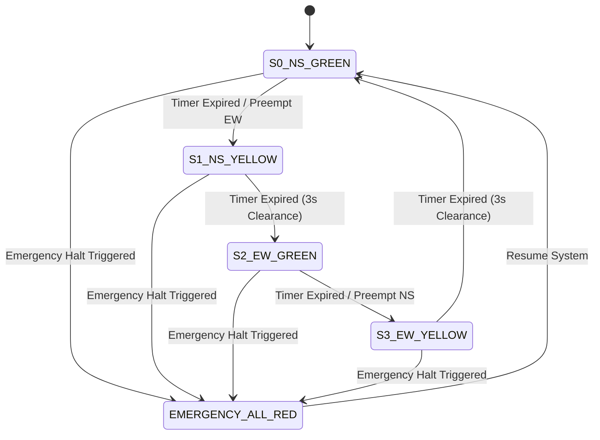

# Finite State Machine (FSM) Design & Formal Specification

## 1. Formal Mathematical Model

The traffic junction controller is formalized as a deterministic finite-state automaton represented by the 6-tuple:
$$M = (Q, \Sigma, \delta, q_0, F, \lambda)$$

Where:
- **$Q$ (State Space)**: The set of discrete operational states:
  $$Q = \{S_0, S_1, S_2, S_3, S_{\text{HALT}}\}$$
- **$\Sigma$ (Input Alphabet)**: The set of control inputs and sensory triggers:
  $$\Sigma = \{\text{TICK}, \text{EXPIRE}, \text{HALT\_CMD}, \text{RESUME\_CMD}, \text{PREEMPT\_REQ}, \text{PREEMPT\_CLEAR}, \text{RESET\_CMD}\}$$
- **$\delta : Q \times \Sigma \to Q$ (State Transition Function)**: Governs state changes based on elapsed timers and asynchronous control commands.
- **$q_0 = S_0$ (Initial State)**: High-throughput North-South green phase.
- **$F = \emptyset$**: The automaton is non-terminating and cyclic under nominal operating conditions.
- **$\lambda : Q \to \Omega$ (Output Mapping Function)**: Maps each state to the 4-way signal vector:
  $$\Omega = \{(\text{Lamp}_N, \text{Lamp}_S, \text{Lamp}_E, \text{Lamp}_W) \mid \text{Lamp}_i \in \{\text{GREEN}, \text{YELLOW}, \text{RED}\}\}$$

---

## 2. State Space & Output Definitions

The intersection coordinates two orthogonal vehicular corridors:
- **Corridor 1 (North-South)**: Governs approaches $N$ and $S$.
- **Corridor 2 (East-West)**: Governs approaches $E$ and $W$.

| State | Code Identifier | Corridor 1 (NS) Signal | Corridor 2 (EW) Signal | Nominal Duration | Purpose / Phase Description |
|---|---|---|---|---|---|
| **$S_0$** | `S0_NS_GREEN` | **GREEN** | **RED** | $10\text{ s}$ (Adaptive $5\text{--}25\text{ s}$) | Primary North-South traffic movement |
| **$S_1$** | `S1_NS_YELLOW` | **YELLOW** | **RED** | $3\text{ s}$ (Strict Constant) | North-South clearance interval |
| **$S_2$** | `S2_EW_GREEN` | **RED** | **GREEN** | $10\text{ s}$ (Adaptive $5\text{--}25\text{ s}$) | Primary East-West traffic movement |
| **$S_3$** | `S3_EW_YELLOW` | **RED** | **YELLOW** | $3\text{ s}$ (Strict Constant) | East-West clearance interval |
| **$S_{\text{HALT}}$**| `EMERGENCY_ALL_RED`| **RED** | **RED** | Indefinite (Until Resumed) | Fail-safe all-stop emergency halt |

---

## 3. State Transition Matrix & Logic



### Complete Transition Logic Table

| Current State | Input / Condition | Guard Condition | Next State | Action Executed |
|---|---|---|---|---|
| **$S_0$** | $\text{TICK}$ | $\text{Timer} > 0$ | $S_0$ | Decrement timer |
| **$S_0$** | $\text{EXPIRE}$ | $\text{Timer} \le 0 \land \neg \text{PreemptLocked}$ | $S_1$ | Load $S_1$ duration ($3\text{ s}$), set NS to YELLOW |
| **$S_0$** | $\text{PREEMPT\_REQ}$ | Emergency on EW corridor | $S_1$ | Initiate immediate transition to yellow clearance |
| **$S_0$** | $\text{HALT\_CMD}$ | None | $S_{\text{HALT}}$ | Force all signals to RED, preserve previous state |
| **$S_1$** | $\text{TICK}$ | $\text{Timer} > 0$ | $S_1$ | Decrement timer |
| **$S_1$** | $\text{EXPIRE}$ | $\text{Timer} \le 0$ | $S_2$ | Load $S_2$ duration (Adaptive), set EW to GREEN |
| **$S_1$** | $\text{HALT\_CMD}$ | None | $S_{\text{HALT}}$ | Force all signals to RED |
| **$S_2$** | $\text{TICK}$ | $\text{Timer} > 0$ | $S_2$ | Decrement timer |
| **$S_2$** | $\text{EXPIRE}$ | $\text{Timer} \le 0 \land \neg \text{PreemptLocked}$ | $S_3$ | Load $S_3$ duration ($3\text{ s}$), set EW to YELLOW |
| **$S_2$** | $\text{PREEMPT\_REQ}$ | Emergency on NS corridor | $S_3$ | Initiate immediate transition to yellow clearance |
| **$S_2$** | $\text{HALT\_CMD}$ | None | $S_{\text{HALT}}$ | Force all signals to RED |
| **$S_3$** | $\text{TICK}$ | $\text{Timer} > 0$ | $S_3$ | Decrement timer |
| **$S_3$** | $\text{EXPIRE}$ | $\text{Timer} \le 0$ | $S_0$ | Load $S_0$ duration (Adaptive), set NS to GREEN |
| **$S_3$** | $\text{HALT\_CMD}$ | None | $S_{\text{HALT}}$ | Force all signals to RED |
| **$S_{\text{HALT}}$** | $\text{RESUME\_CMD}$ | Operator reset | $S_0$ | Restore nominal state, re-arm timers |

---

## 4. Formal Safety Invariant Proofs

The integrity of the intersection relies on three invariant properties that must hold true across all reachable system configurations.

### 4.1 Invariant 1: Conflicting Green Mutex
> **Theorem**: Signals for orthogonal traffic directions shall *never* be non-red simultaneously.

$$\forall t \ge 0, \quad \neg \Big( \big(L_N(t) = \text{GREEN} \lor L_S(t) = \text{GREEN}\big) \land \big(L_E(t) = \text{GREEN} \lor L_W(t) = \text{GREEN}\big) \Big)$$

**Proof by Exhaustion of State Space**:
1. In state $S_0$: $L_N = \text{GREEN}, L_S = \text{GREEN}, L_E = \text{RED}, L_W = \text{RED}$. Since $L_E \ne \text{GREEN}$ and $L_W \ne \text{GREEN}$, the conjunction evaluates to $\text{TRUE} \land \text{FALSE} = \text{FALSE}$.
2. In state $S_1$: $L_N = \text{YELLOW}, L_S = \text{YELLOW}, L_E = \text{RED}, L_W = \text{RED}$. Neither corridor has green, condition is $\text{FALSE} \land \text{FALSE} = \text{FALSE}$.
3. In state $S_2$: $L_N = \text{RED}, L_S = \text{RED}, L_E = \text{GREEN}, L_W = \text{GREEN}$. Conjunction is $\text{FALSE} \land \text{TRUE} = \text{FALSE}$.
4. In state $S_3$: $L_N = \text{RED}, L_S = \text{RED}, L_E = \text{YELLOW}, L_W = \text{YELLOW}$. Conjunction is $\text{FALSE} \land \text{FALSE} = \text{FALSE}$.
5. In state $S_{\text{HALT}}$: All approaches are $\text{RED}$. Conjunction is $\text{FALSE} \land \text{FALSE} = \text{FALSE}$.
$$\therefore \text{Invariant 1 holds across all valid states } Q. \quad \blacksquare$$

### 4.2 Invariant 2: Clearance Isolation Invariant
> **Theorem**: An active approach clearing the intersection ($L = \text{YELLOW}$) shall never overlap with an active cross-approach ($L \in \{\text{GREEN}, \text{YELLOW}\}$).

$$\forall t \ge 0, \quad \neg \Big( \text{Active}_{\text{NS}}(t) \land \text{Active}_{\text{EW}}(t) \Big)$$
where $\text{Active}_k(t) \iff (L_k(t) = \text{GREEN} \lor L_k(t) = \text{YELLOW})$.

**Proof**:
- In $S_0$: $\text{Active}_{\text{NS}} = \text{TRUE}$, $\text{Active}_{\text{EW}} = \text{FALSE} \implies \text{Isolated}$.
- In $S_1$: $\text{Active}_{\text{NS}} = \text{TRUE}$, $\text{Active}_{\text{EW}} = \text{FALSE} \implies \text{Isolated}$.
- In $S_2$: $\text{Active}_{\text{NS}} = \text{FALSE}$, $\text{Active}_{\text{EW}} = \text{TRUE} \implies \text{Isolated}$.
- In $S_3$: $\text{Active}_{\text{NS}} = \text{FALSE}$, $\text{Active}_{\text{EW}} = \text{TRUE} \implies \text{Isolated}$.
- In $S_{\text{HALT}}$: Both are $\text{FALSE} \implies \text{Isolated}$.
$$\therefore \text{No simultaneous motion authorization is possible. } \quad \blacksquare$$

### 4.3 Invariant 3: Yellow Clearance Non-Bypass
> **Theorem**: Under no operational mode (Fixed, Adaptive, Manual, or Emergency Preemption) may a green phase on one axis directly transition into a green phase on the orthogonal axis without an intervening clearance phase:

$$\delta(S_0, \sigma) \ne S_2, \quad \delta(S_2, \sigma) \ne S_0, \quad \forall \sigma \in \Sigma$$

---

## 5. Invariant Enforcement & Synthetic Fault Injection

The FSM engine includes runtime assertions that continuously evaluate light outputs after every state modification. If an anomalous state vector is detected, the engine raises an exception and forces an immediate transition to $S_{\text{HALT}}$:

```javascript
verifySafetyInvariant() {
  const lights = this.getLights();
  const nsGreen = lights.north === 'GREEN' || lights.south === 'GREEN';
  const ewGreen = lights.east === 'GREEN' || lights.west === 'GREEN';
  if (nsGreen && ewGreen) {
    return { valid: false, code: 'ERR_DUAL_GREEN', message: 'CRITICAL: Dual conflicting greens detected!' };
  }
  const nsActive = lights.north !== 'RED' || lights.south !== 'RED';
  const ewActive = lights.east !== 'RED' || lights.west !== 'RED';
  if (nsActive && ewActive) {
    return { valid: false, code: 'ERR_DUAL_ACTIVE', message: 'CRITICAL: Dual active clearance detected!' };
  }
  return { valid: true };
}
```

The automated test suite in [`verify.js`](file:///c:/Users/Abishek/OneDrive/Desktop/dpco-oss/Traffic-Light-Controller/verify.js) performs synthetic fault injection (Tests 9 and 10), verifying that if an illegal dual green or dual active state is forcibly injected, the safety monitor immediately traps the fault and halts the controller.
